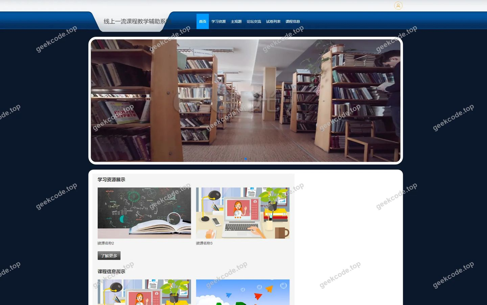
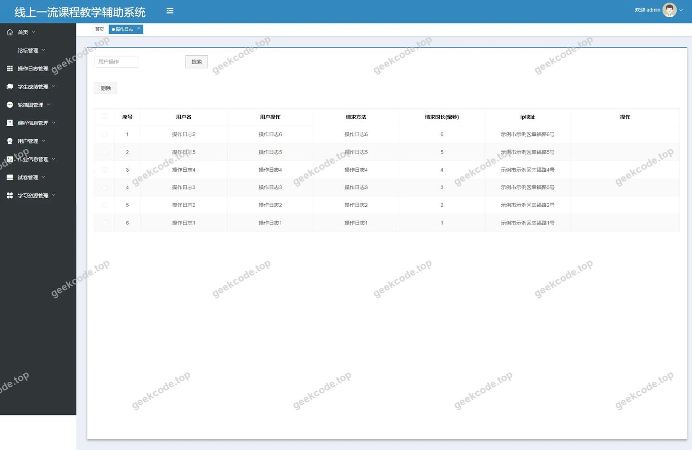
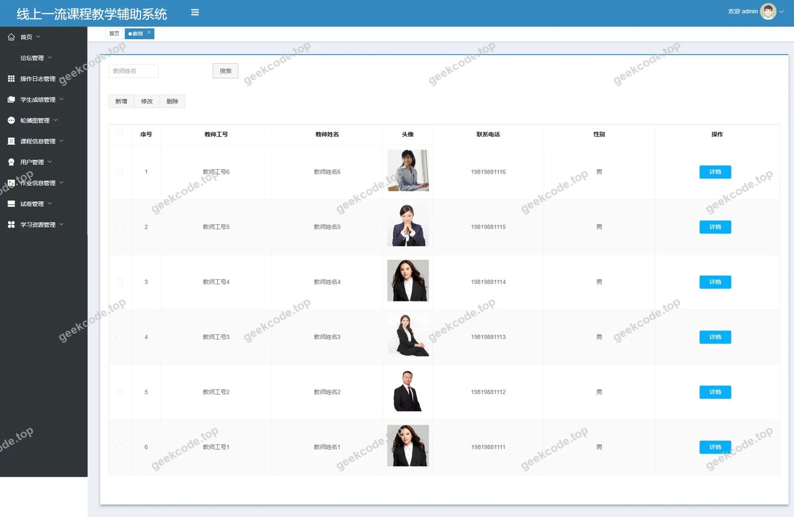
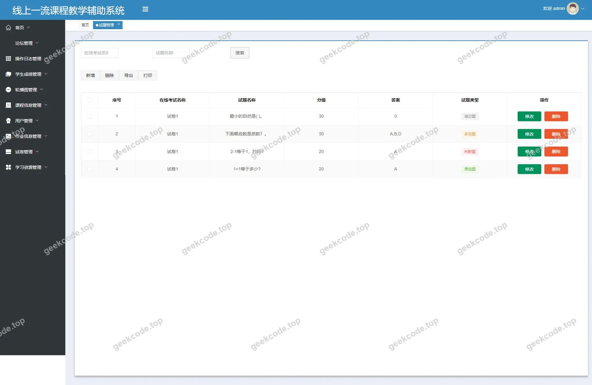
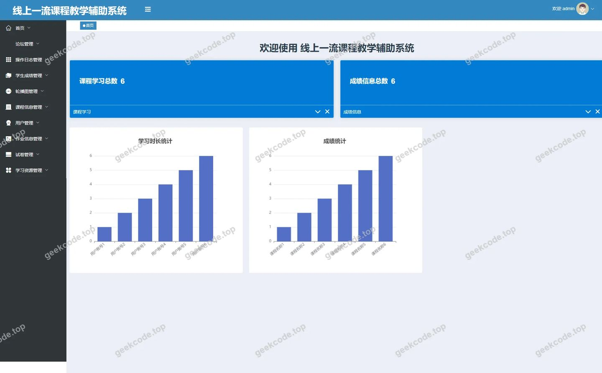
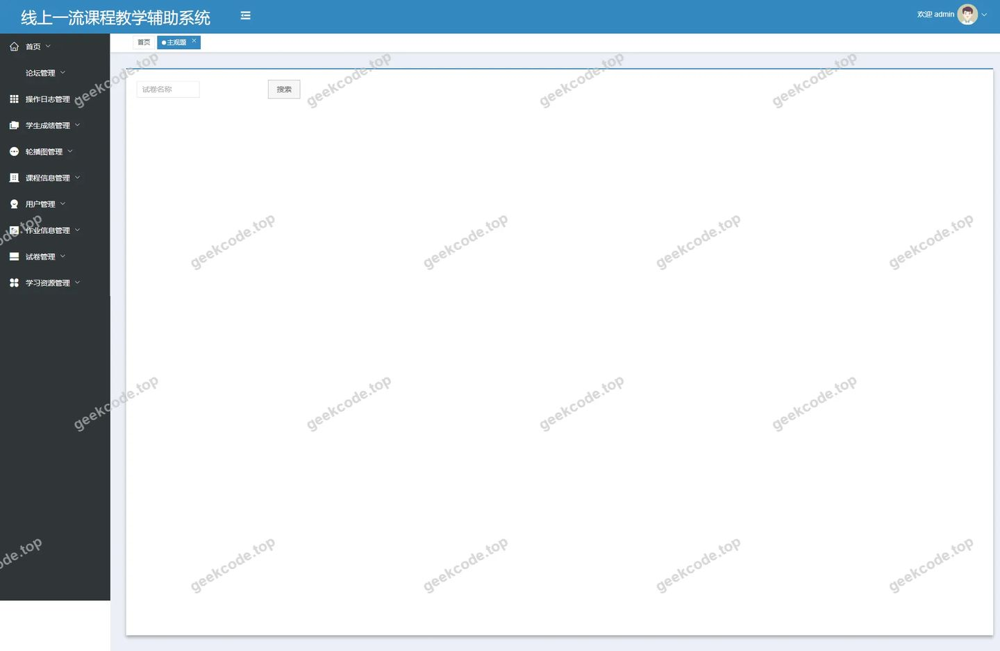
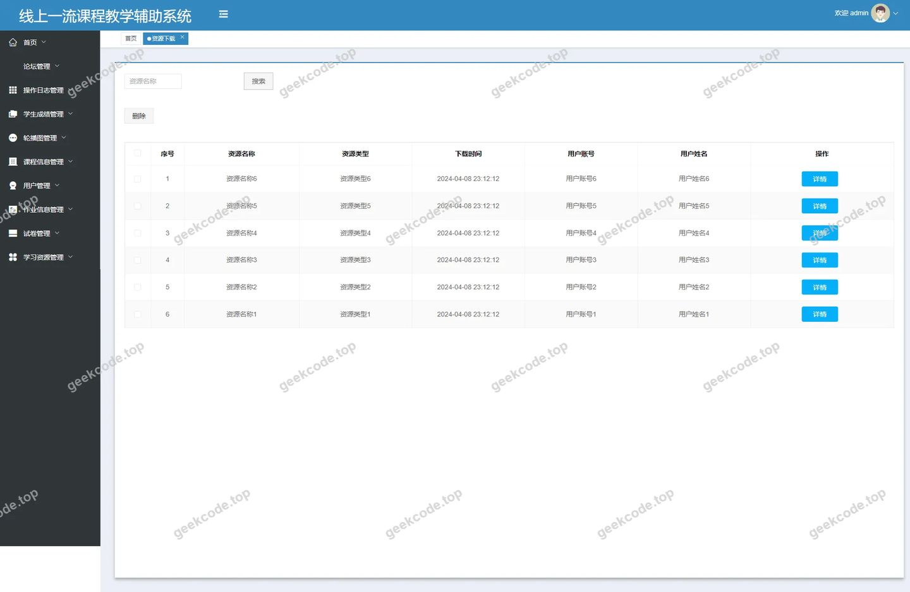

# Java线上一流课程教学辅助系统

> 🎓 **计算机毕业设计 · Java线上一流课程教学辅助系统**
>
> 本仓库只放**项目介绍 + 运行截图**（截图是站点带水印的原图，存在仓库 `images/` 里）。
>
> 👉 **完整可运行源码 / 数据库脚本 / 部署文档：[点我获取](https://geekcode.top/archives/Java%E7%BA%BF%E4%B8%8A%E4%B8%80%E6%B5%81%E8%AF%BE%E7%A8%8B%E6%95%99%E5%AD%A6%E8%BE%85%E5%8A%A9%E7%B3%BB%E7%BB%9F?utm_source=github)**
>
> 💬 咨询微信：**ir9372**　|　🌐 更多项目：[极客代码 geekcode.top](https://geekcode.top/?utm_source=github)
>
> 📌 项目详情页：<https://geekcode.top/archives/Java%E7%BA%BF%E4%B8%8A%E4%B8%80%E6%B5%81%E8%AF%BE%E7%A8%8B%E6%95%99%E5%AD%A6%E8%BE%85%E5%8A%A9%E7%B3%BB%E7%BB%9F?utm_source=github>

<table><td width="230" align="center"> <b>扫码加微信 ir9372</b></td><td valign="middle">📦 源码 = 项目介绍 + 全部运行截图 + 数据库 + 部署文档 👉 点上方任意截图，直接跳到 <b>极客代码 geekcode.top</b> 详情页</td></table>

---

<h1>Java线上一流课程教学辅助系统</h1>
<h2>项目概述</h2>

本项目名为“Java线上一流课程教学辅助系统”，旨在构建一个集课程资源管理、在线考试评测及师生互动于一体的综合性教育服务平台。系统采用前后端分离架构，核心功能涵盖课程信息管理、学习资源分类与下载、作业发布与提交、客观题与主观题的在线考试及成绩统计等模块。适用人群包括学生、教师及系统管理员，分别对应前台用户学习与后台资源维护场景。技术架构基于 Spring Boot 后端框架，结合 MyBatis-Plus 进行数据持久化操作，并利用 Apache Shiro 实现细粒度的权限控制，确保系统的安全性与稳定性，有效支撑线上教学资源的数字化管理与高效分发。

<h2>技术架构</h2>

<strong>1. 前后端架构设计</strong>
项目采用 Vue 前端与 Java 后端分离的开发模式（vue-integrated）。

<ul>
<li><strong>后端层</strong>：基于 Spring Boot 快速搭建应用骨架，集成 <code>spring-boot-starter-web</code>处理 HTTP 请求，使用 <code>mybatis-spring-boot-starter</code> 和 <code>mybatis-plus</code> 简化数据库交互逻辑，通过 <code>shiro-spring</code> 实现身份认证与授权管理。</li>
<li><strong>前端层</strong>：虽然具体前端代码未提供，但根据路由结构可知，前端负责渲染用户界面并与后端 RESTful API 进行数据交互。路由分为 <code>/index/...</code>（前台用户视角）和后台独立路由（如 <code>/jiaoshi</code>, <code>/examquestion</code> 等），体现了清晰的视图分层。</li>
</ul>

<strong>2. 核心技术选型理由</strong>

<ul>
<li><strong>Spring Boot</strong>: 提供自动配置和内嵌容器，降低部署复杂度，适合快速迭代开发。</li>
<li><strong>MyBatis-Plus</strong>: 在 MyBatis 基础上增强 CRUD 能力，减少样板代码，提升开发效率，同时保持对复杂 SQL 的支持。</li>
<li><strong>Apache Shiro</strong>: 轻量级安全框架，适用于单体或微服务架构下的权限控制，支持会话管理和加密机制，保障用户数据隐私。</li>
<li><strong>MySQL &amp; JDBC</strong>: 作为关系型数据库存储核心业务数据，配合 <code>mysql-connector-java</code> 驱动实现高效连接。</li>
</ul>

<strong>3. 数据库设计要点</strong>
根据后台路由映射，数据库主要包含以下核心实体表：

<ul>
<li><strong>用户相关</strong>：<code>yonghu</code> (用户), <code>jiaoshi</code> (教师)。</li>
<li><strong>教学资源</strong>：<code>kechengxinxi</code> (课程信息), <code>kechengfenlei</code> (课程分类), <code>xuexiziyuan</code> (学习资源), <code>ziyuanleixing</code> (资源类型), <code>ziyuanxiazai</code> (资源下载记录)。</li>
<li><strong>考试与作业</strong>：<code>examquestion</code> (试题), <code>zhuguanti</code> (主观题), <code>exampaper</code> (试卷), <code>zuoyefafang</code> (作业发布), <code>zuoyetijiao</code> (作业提交), <code>tijiaodaan</code> (答案提交), <code>examrecord</code> (考试记录), <code>examfailrecord</code> (失败记录), <code>pigaixinxi</code> (批改信息), <code>chengjixinxi</code> (成绩信息)。</li>
<li><strong>系统与日志</strong>：<code>syslog</code> (系统日志), <code>config</code> (配置信息), <code>forum</code> (论坛/讨论区), <code>discusskechengxinxi</code> (课程讨论), <code>discussxuexiziyuan</code> (资源讨论), <code>storeup</code> (收藏)。</li>
</ul>
<h2>功能模块</h2>
<h3>前台用户端功能</h3>

前台路由以 <code>/index/</code> 开头，主要面向注册用户（学生/教师）提供学习与管理个人内容的接口。

<table>
<thead>
<tr>
<th align="left">模块名称</th>
<th align="left">功能描述</th>
</tr>
</thead>
<tbody><tr>
<td align="left"><strong>用户中心</strong></td>
<td align="left">包括用户列表查看 (<code>yonghuList</code>)、详情 (<code>yonghuDetail</code>)、注册添加 (<code>yonghuAdd</code>) 及个人中心入口 (<code>yonghuCenter</code>)。</td>
</tr>
<tr>
<td align="left"><strong>课程浏览</strong></td>
<td align="left">展示课程分类 (<code>kechengfenleiList/Detail/Add</code>) 和具体课程信息 (<code>kechengxinxiList/Detail/Add</code>)，支持课程内容的检索与查看详情。</td>
</tr>
<tr>
<td align="left"><strong>资源管理</strong></td>
<td align="left">提供学习资源 (<code>xuexiziyuanList/Detail/Add</code>) 和资源类型 (<code>ziyuanleixingList/Detail/Add</code>) 的浏览与维护；支持资源下载记录查询 (<code>ziyuanxiazaiList/Detail/Add</code>)。</td>
</tr>
<tr>
<td align="left"><strong>互动社区</strong></td>
<td align="left">包含论坛板块 (<code>forumList</code>)，以及针对课程 (<code>discusskechengxinxi</code>) 和学习资源 (<code>discussxuexiziyuan</code>) 的评论与讨论功能。</td>
</tr>
<tr>
<td align="left"><strong>个人收藏</strong></td>
<td align="left">用户可查看和管理自己的收藏内容 (<code>storeupList</code>)。</td>
</tr>
<tr>
<td align="left"><strong>作业与考试</strong></td>
<td align="left">支持作业的发布 (<code>zuoyefafangList/Detail/Add</code>) 与提交 (<code>zuoyetijiaoList/Detail/Add</code>)；涉及试题 (<code>examquestion</code>)、试卷 (<code>exampaper</code>) 及相关记录的查看。</td>
</tr>
<tr>
<td align="left"><strong>系统日志</strong></td>
<td align="left">普通用户可访问部分系统日志信息 (<code>syslogList/Detail/Add</code>)，通常用于审计或个人操作记录查询。</td>
</tr>
</tbody></table>
<h3>后台管理端功能</h3>

后台路由无 <code>/index/</code> 前缀，直接暴露管理接口，供管理员或特定角色进行全局配置与数据处理。

<table>
<thead>
<tr>
<th align="left">模块名称</th>
<th align="left">功能描述</th>
</tr>
</thead>
<tbody><tr>
<td align="left"><strong>教师管理</strong></td>
<td align="left">教师的增删改查及个人中心管理 (<code>/jiaoshi</code>, <code>/jiaoshiCenter</code>)。</td>
</tr>
<tr>
<td align="left"><strong>资源体系管理</strong></td>
<td align="left">统一管理资源类型 (<code>/ziyuanleixing</code>)、学习资源 (<code>/xuexiziyuan</code>) 及下载记录 (<code>/ziyuanxiazai</code>)。</td>
</tr>
<tr>
<td align="left"><strong>考试全流程管理</strong></td>
<td align="left">1. <strong>题库管理</strong>：试题 (<code>/examquestion</code>)、主观题 (<code>/zhuguanti</code>)。2. <strong>试卷管理</strong>：试卷生成与列表 (<code>/exampaper</code>, <code>/exampaperlist</code>)。3. <strong>考试执行</strong>：考试记录 (<code>/examrecord</code>)、失败记录 (<code>/examfailrecord</code>)、整体考试状态监控 (<code>/examination</code>)。4. <strong>阅卷与成绩</strong>：答题提交 (<code>/tijiaodaan</code>)、批改信息 (<code>/pigaixinxi</code>)、成绩信息 (<code>/chengjixinxi</code>)。</td>
</tr>
<tr>
<td align="left"><strong>作业管理</strong></td>
<td align="left">作业发布 (<code>/zuoyefafang</code>) 与学生提交情况监控 (<code>/zuoyetijiao</code>)。</td>
</tr>
<tr>
<td align="left"><strong>内容与互动管理</strong></td>
<td align="left">课程信息管理 (<code>/kechengxinxi</code>)、课程分类 (<code>/kechengfenlei</code>)、课程学习进度 (<code>/kechengxuexi</code>)、论坛管理 (<code>/forum</code>) 及各类讨论内容审核 (<code>/discusskechengxinxi</code>, <code>/discussxuexiziyuan</code>)。</td>
</tr>
<tr>
<td align="left"><strong>系统基础设置</strong></td>
<td align="left">用户管理 (<code>/yonghu</code>)、系统日志审计 (<code>/syslog</code>)、系统参数配置 (<code>/config</code>)、收藏内容管理 (<code>/storeup</code>)。</td>
</tr>
</tbody></table>
<h2>用户角色与权限</h2>

根据路由结构和典型的教学系统设计，推断出以下三类主要角色及其权限范围。由于未提供具体的 RBAC 数据库表结构，权限分配基于路由语义和功能必要性进行逻辑推导。

<h3>1. 超级管理员 (Admin)</h3>

拥有系统的最高权限，负责全局配置和数据维护。

<ul>
<li><strong>可访问模块</strong>：所有后台路由。</li>
<li><strong>具体权限</strong>：</li>
<li><strong>用户管理</strong>：创建、编辑、删除教师 (<code>/jiaoshi</code>) 和学生 (<code>/yonghu</code>) 账号。</li>
<li><strong>资源管控</strong>：定义资源类型 (<code>/ziyuanleixing</code>)，上传或删除学习资源 (<code>/xuexiziyuan</code>)，监控下载行为 (<code>/ziyuanxiazai</code>)。</li>
<li><strong>考试配置</strong>：管理试题库 (<code>/examquestion</code>, <code>/zhuguanti</code>)，组装试卷 (<code>/exampaper</code>)，查看所有学生的考试记录和成绩 (<code>/examrecord</code>, <code>/chengjixinxi</code>)。</li>
<li><strong>系统运维</strong>：查看全量系统日志 (<code>/syslog</code>)，修改系统配置 (<code>/config</code>)，审核论坛及评论内容 (<code>/forum</code>, <code>/discuss...</code>)。</li>
</ul>
<h3>2. 教师 (Teacher)</h3>

负责教学内容制作、作业发布及学生考核。

<ul>
<li><strong>可访问模块</strong>：部分后台路由 + 前台 <code>/index/</code> 路由中的教学相关部分。</li>
<li><strong>具体权限</strong>：</li>
<li><strong>个人中心</strong>：通过 <code>/jiaoshiCenter</code> 管理个人资料。</li>
<li><strong>教学资料</strong>：发布和维护课程信息 (<code>/kechengxinxi</code>)，上传学习资料 (<code>/xuexiziyuan</code>)。</li>
<li><strong>作业与考试</strong>：发布作业 (<code>/zuoyefafang</code>)，接收并批改学生提交的作业 (<code>/zuoyetijiao</code>, <code>/pigaixinxi</code>)；创建试题 (<code>/examquestion</code>)，发布考试 (<code>/examination</code>)，查看本班学生的考试成绩 (<code>/chengjixinxi</code>)。</li>
<li><strong>互动管理</strong>：回复学生关于课程 (<code>/discusskechengxinxi</code>) 或资源 (<code>/discussxuexiziyuan</code>) 的提问。</li>
</ul>
<h3>3. 学生 (Student)</h3>

系统的主要使用者，专注于学习、作业提交和参加考试。

<ul>
<li><strong>可访问模块</strong>：前台 <code>/index/</code> 路由为主。</li>
<li><strong>具体权限</strong>：</li>
<li><strong>基础服务</strong>：注册登录 (<code>/index/yonghuAdd</code>)，查看个人信息 (<code>/index/yonghuCenter</code>)。</li>
<li><strong>学习过程</strong>：浏览课程分类 (<code>/index/kechengfenleiList</code>)，查看课程详情 (<code>/index/kechengxinxiDetail</code>)，下载学习资源 (<code>/index/ziyuanxiazaiList</code>)，收藏感兴趣的内容 (<code>/index/storeupList</code>)。</li>
<li><strong>考核环节</strong>：接收作业通知并提交 (<code>/index/zuoyetijiaoAdd</code>)；参与在线考试，查看试卷 (<code>/index/exampaperList</code>)，提交答案 (<code>/index/tijiaodaan</code>)，查询个人历史考试记录 (<code>/index/examrecord</code>)。</li>
<li><strong>交流互动</strong>：在论坛发帖 (<code>/index/forumList</code>)，对课程和资源发表评论 (<code>/index/discuss...</code>)。</li>
</ul>

<em>(注：前台路由中出现的 <code>Add</code> 操作如 <code>/index/yonghuAdd</code> 通常指注册流程，而 <code>/index/kechengxinxiAdd</code> 等若对学生开放则意味着允许学生贡献内容，但在常规教学系统中，此类创建权限通常仅保留给教师或管理员，此处依据路由存在性列出，实际权限需由后端拦截器严格控制)</em>

<h2>项目特色与创新点</h2>
<ol>
<li>
<strong>全流程数字化教学闭环</strong>：
   系统覆盖了从“资源准备”（课程、试题、作业）到“教学过程”（学习、讨论、下载）再到“结果评估”（考试、批改、成绩）的完整链路。特别是将客观题 (<code>examquestion</code>) 与主观题 (<code>zhuguanti</code>) 分开管理，并引入了详细的批改信息 (<code>pigaixinxi</code>) 和失败记录 (<code>examfailrecord</code>)，使得考试评价体系更加精细化和可追溯。

</li>
<li>
<strong>多维度的互动反馈机制</strong>：
   除了传统的论坛 (<code>forum</code>)，系统专门设计了针对“课程信息”和“学习资源”的独立讨论模块 (<code>discusskechengxinxi</code>, <code>discussxuexiziyuan</code>)。这种上下文相关的评论机制有助于提高师生互动的针对性，便于教师收集特定知识点或资料的反馈，优化教学内容。

</li>
<li>
<strong>灵活的资源管理体系</strong>：
   通过 <code>ziyuanleixing</code> (资源类型) 和 <code>kechengfenlei</code> (课程分类) 的双维度分类，结合 <code>storeup</code> (收藏) 功能，实现了资源的结构化存储与个性化推荐的基础。<code>ziyuanxiazai</code> 表的存在表明系统具备资源分发的追踪能力，可用于分析热门资源，辅助教学决策。

</li>
<li>
<strong>稳健的安全与审计架构</strong>：
   集成 Apache Shiro 确保了身份认证的安全性，而独立的 <code>syslog</code> (系统日志) 模块不仅记录操作行为，还将其纳入前台可见范围（可能用于透明度展示或特定权限查询），体现了系统在可审计性和安全性方面的考量。

</li>
</ol>
<h2>部署环境</h2>

根据提供的依赖列表和技术栈，运行本项目所需的软件环境如下：

<table>
<thead>
<tr>
<th align="left">组件</th>
<th align="left">版本要求/建议</th>
<th align="left">说明</th>
</tr>
</thead>
<tbody><tr>
<td align="left"><strong>JDK</strong></td>
<td align="left">JDK 1.8 或以上</td>
<td align="left">Spring Boot 和 Shiro 的基础运行环境。</td>
</tr>
<tr>
<td align="left"><strong>Maven</strong></td>
<td align="left">3.6+</td>
<td align="left">用于项目管理与依赖下载（隐含需求，因使用了 spring-boot-starter 等 Maven 坐标）。</td>
</tr>
<tr>
<td align="left"><strong>MySQL</strong></td>
<td align="left">5.7 或 8.0</td>
<td align="left">数据存储引擎，需安装 <code>mysql-connector-java</code> 对应的驱动兼容版本。</td>
</tr>
<tr>
<td align="left"><strong>Node.js</strong></td>
<td align="left">LTS 版本 (如 v14/v16)</td>
<td align="left">用于编译和运行 Vue 前端项目（基于 vue-integrated 特性）。</td>
</tr>
<tr>
<td align="left"><strong>Redis</strong></td>
<td align="left"><em>(可选)</em></td>
<td align="left">虽未在依赖中明确列出 <code>spring-boot-starter-data-redis</code>，但若 Shiro Session 需要分布式共享或缓存高频数据，生产环境建议部署 Redis。根据现有依赖，默认可能使用内存或 JDBC 存储 Session。</td>
</tr>
<tr>
<td align="left"><strong>Web 服务器</strong></td>
<td align="left">Nginx / Tomcat</td>
<td align="left">Nginx 用于反向代理前端静态资源及负载均衡；Tomcat 为 Spring Boot 内嵌容器，无需单独安装，但生产环境常配合 Nginx 使用。</td>
</tr>
<tr>
<td align="left"><strong>操作系统</strong></td>
<td align="left">Linux (CentOS/Ubuntu) 或 Windows Server</td>
<td align="left">推荐 Linux 环境以获得更好的服务器性能和稳定性。</td>
</tr>
</tbody></table>
<h2>五、技术特性</h2>
<ul>
<li>前后端集成部署，前端资源打包至后端 static 目录</li>
<li>使用 MyBatis-Plus 简化数据访问层开发</li>
<li>集成 Shiro 权限框架实现角色权限控制</li>
</ul>
<h2>六、功能模块截图</h2>
<h3>前台用户端</h3>
<h4>前台-首页</h4>

<h4>前台-登录</h4>

<h4>前台-用户注册</h4>

<h3>后台管理端</h3>
<h4>后台-操作日志</h4>

<h4>后台-登录页</h4>

<h4>后台-教师</h4>

<h4>后台-试题管理</h4>

<h4>页面-首页</h4>

<h4>后台-主观题</h4>

<h4>后台-资源类型</h4>

<h4>后台-资源下载</h4>

---

## 获取完整源码

| 项目 | 说明 |
| --- | --- |
| 项目名 | Java线上一流课程教学辅助系统 |
| 运行截图 | 本文 11 张（站点带水印原图，仓库 `images/` 目录） |
| 完整源码 | [https://geekcode.top/archives/Java%E7%BA%BF%E4%B8%8A%E4%B8%80%E6%B5%81%E8%AF%BE%E7%A8%8B%E6%95%99%E5%AD%A6%E8%BE%85%E5%8A%A9%E7%B3%BB%E7%BB%9F?utm_source=github](https://geekcode.top/archives/Java%E7%BA%BF%E4%B8%8A%E4%B8%80%E6%B5%81%E8%AF%BE%E7%A8%8B%E6%95%99%E5%AD%A6%E8%BE%85%E5%8A%A9%E7%B3%BB%E7%BB%9F?utm_source=github) |
| 咨询微信 | **ir9372**（备注：jingpin-yuanma） |
| 更多项目 | [极客代码 geekcode.top](https://geekcode.top/?utm_source=github) |

> 需要源码、部署、改配置、跑不起来等问题，加微信 ir9372 沟通，说明项目名即可。
